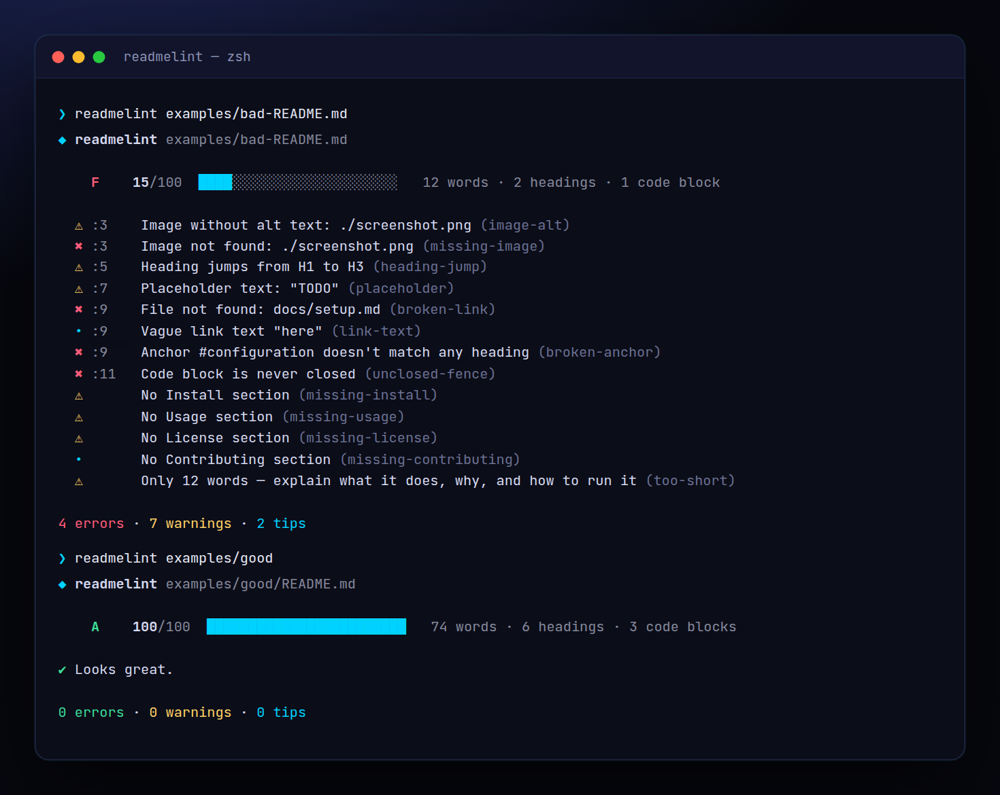

<!-- ═════════════ HEADER ═════════════ -->
<p align="center">
  
</p>

<p align="center">
  
</p>

<p align="center">
  <a href="https://github.com/krishyaa06/prism-readme-lint/actions/workflows/ci.yml"></a>
  
  
  <a href="LICENSE"></a>
</p>

<p align="center">
  
</p>


## ⚡ Overview

**Prism README Lint** (`readmelint`) is a quick health check for the most important file in your repo. It gives the README an **A–F grade** and points at exactly what to fix: links to files that don't exist, images that 404, `#anchors` that don't match any heading (using GitHub's slug rules), missing Install / Usage / License sections, heading level jumps, images without alt text, unclosed code blocks and leftover `TODO` / `lorem ipsum`. Use `--min 80` to keep it an A in CI.

## ✨ Features

- **A–F grade** + score out of 100 (errors −12, warnings −5, tips −1)
- **Broken links & images**: relative files are checked on disk; `#anchors` checked against GitHub-style heading slugs
- **Structure**: title, description, Install / Usage / License / Contributing sections, heading jumps, duplicate headings
- **Accessibility**: images (Markdown and ``) without alt text, vague "click here" links
- **Code blocks**: unclosed fences, missing language tags. Content inside code is never linted
- `--min <score>` for CI, `--quiet`, `--json`, `--no-files`. Zero dependencies

## 🚀 Quick Start

```bash
# run without installing
npx github:krishyaa06/prism-readme-lint 

# or install globally
npm install -g github:krishyaa06/prism-readme-lint
readmelint --min 80
```

Requires Node.js 18.17+. No dependencies.

## 🛠️ Usage

```text
readmelint [file|dir] [options]

    --min <score>    exit 1 if the score is below this (default 0, CI: 80)
    --quiet          only errors
    --no-files       don't check that linked files exist
    --json           machine-readable output
```

### Rules

| Level | Rules |
|---|---|
| error | `title`, `broken-link`, `missing-image`, `broken-anchor`, `empty-link`, `unclosed-fence` |
| warn | `missing-install`, `missing-usage`, `missing-license`, `heading-jump`, `multiple-h1`, `image-alt`, `placeholder`, `too-short`, `no-code`, `localhost-link` |
| tip | `missing-contributing`, `fence-lang`, `link-text`, `no-visual`, `http-link` |

### In CI

```yaml
- run: npx --yes github:krishyaa06/prism-readme-lint --min 80
```

## 📁 Project Structure

```text
prism-readme-lint/
├── assets/
│   ├── logo.png
│   └── logo.svg
├── bin/
│   └── readmelint.js   # CLI entry
├── examples/
│   ├── good/   # an A-grade README
│   │   ├── assets/
│   │   │   └── logo.svg
│   │   └── README.md
│   └── bad-README.md   # every mistake
├── src/
│   ├── index.js   # markdown scanner + rules + score
│   └── ui.js   # colours, tables
├── test/
│   └── readmelint.test.js
├── .gitignore
├── LICENSE
├── README.md
└── package.json
```

## 🧪 Tests

```bash
npm test
```

Tests use the built-in `node:test` runner, so there is nothing to install. CI runs them on Node 20 and 22.

## 🤝 Contributing

1. Fork the repo and create a branch: `git checkout -b feature/my-idea`
2. Make your change and add a test in `test/`
3. Run `npm test` and open a Pull Request

## 🔷 Part of Prism Protocol

Prism README Lint is one of the open-source tools built by [Prism Protocol](https://dc.gg/prismprotocol), a tech community where young builders learn, ship and compete together.

## 👤 Author

<table>
  <tr>
    <td align="center">
      <a href="https://github.com/krishyaa06"><br><b>Soumya Bhandare</b></a><br>
      <sub>Founder @ Prism Protocol</sub>
    </td>
    <td>
      <a href="https://dc.gg/prismprotocol"></a><br>
      <a href="https://instagram.com/prism_protocol_"></a><br>
      <a href="https://x.com/krishyaa06"></a>
    </td>
  </tr>
</table>

## 📄 License

Released under the [MIT License](LICENSE).

<p align="center">
  <b>If you like this project, consider giving it a ⭐</b><br>
  <sub>"Build. Create. Compete." · Made with ⚡ by Prism Protocol</sub>
</p>


